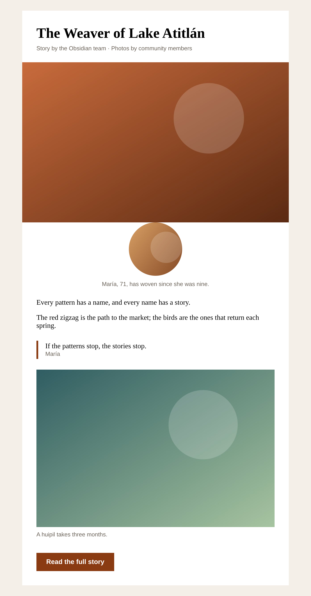

# Photo story → email export, done safely

A small, tested sample of two problems that photo-story platforms commonly hit when stories are exported to email tools like ActiveCampaign:

1. **The email looks different from the template**: circles turn into squares, images change size, the layout collapses in Outlook, or Gmail cuts the email off.
2. **"Images should delete after 30 days"**: done carelessly, this breaks live story pages and every email already sent, because they link to the same files.

The story text and photos are placeholders. No real people.

```bash
npm install
npm test          # 12 tests
npm run sample    # writes out/sample-email.html (open it in a browser)
```

| Desktop (600px column) | Phone |
|---|---|
|  |  |

## 1. Email-safe export (`src/email`)

| What goes wrong in email clients | What the export does |
|---|---|
| Outlook for Windows uses Word to render HTML: flex, grid and positioning collapse | Table layout only, with a 600px Outlook-only wrapper and a fluid column below 600px |
| Outlook ignores CSS image sizes, so photos render at full size | Every `` has `width` and `height` attributes matching the template |
| `border-radius` circles show up as squares in Outlook | Portraits are **baked into a circular PNG** (transparent corners, 2× for retina) with `sharp` |
| Gmail clips emails over ~102 KB behind "View entire message" | The export is ~4 KB of HTML; the linter fails anything over the limit |
| Story text containing `<`, `&` or quotes breaks the HTML | All text is escaped |

`lintEmailHtml()` checks every export against these rules before it is sent, so a regression shows up as a failing test instead of a broken campaign.

## 2. Safe 30-day media cleanup (`src/media/cleanup.ts`)

- Only deletes images that are **older than 30 days and not used by any story**. Images used by published stories are never deleted, so live pages and past emails keep working. Images used only by drafts are protected by default too; that is a setting.
- Deletes the file from storage **before** marking the database row, and S3 deletes are idempotent, so a crash or timeout part-way through can simply be re-run.
- **Dry-run** mode reports what would be deleted without touching anything.

## What this is not

- Not the client's code, and not connected to a real ActiveCampaign or DigitalOcean account.
- Not tested in a paid inbox-preview service (Litmus / Email on Acid). The rules above are the standard fixes for those clients, and a real engagement would confirm them with test sends to Outlook, Gmail and Apple Mail.
